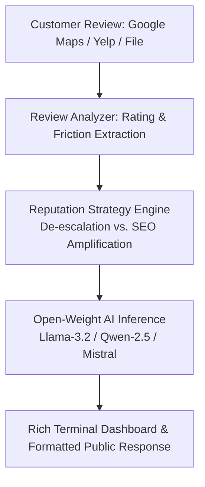

*This is a submission for the [Hacktoberfest Open-Source AI Challenge Week 2: Side Hustle](https://dev.to/challenges/hacktoberfest-week2-2026-10-12)*

## What I Built

Over 30 million small businesses worldwide—from family-owned Italian trattorias and local dental clinics to emergency plumbers and neighborhood mechanics—live and die by their Google Maps and Yelp review scores. 

The reality for these business owners is harsh:
1. **Unanswered 1-Star Reviews Bleed Customers**: A single scathing review left unaddressed on Google Maps can reduce local walk-in foot traffic by up to 22%.
2. **Wasted 5-Star Reviews**: Glowing customer reviews are rarely answered with targeted service keywords, wasting prime Google Local SEO ranking real estate.
3. **Owner Burnout**: After a grueling 14-hour workday, an exhausted bakery owner or plumber does not have the emotional bandwidth or diplomacy to write calm, customer-retaining public de-escalation responses.

Freelance digital marketing consultants routinely charge **$150 to $300 per month per client** to manage and answer online reviews.

To turn this into a scalable, zero-overhead side hustle, I built **`ReviewRescue`**—a lightweight, multi-tone customer reputation copilot powered by **Open-Source AI**. It transforms raw customer rants or glowing testimonials into diplomatic de-escalation strategies, SEO-optimized public replies, and actionable operational fixes for business owners.

### Key Features:
- **Intelligent Sentiment & Friction Auditing**: Parses customer reviews to automatically extract operational pain points (e.g., *Wait Times*, *Staff Attitude*, *Food Temperature*, *Pricing Transparency*).
- **Damage Control & De-escalation (1-2 Stars)**: Produces empathetic, calm public replies that acknowledge customer frustrations, avoid legal liability, and move the conflict offline to private resolution channels.
- **Local SEO Keyword Amplification (4-5 Stars)**: Naturally injects high-intent local search keywords (e.g., *"emergency burst pipe repair in Austin"*, *"wood-fired pizza in downtown"*) into positive responses to boost Google Maps ranking.
- **Tailored Brand Tone Profiles**:
  - `warm`: Neighborhood bakeries, cafes, boutique florists, and family dental practices.
  - `professional`: Medical clinics, law firms, real estate agencies, and B2B services.
  - `direct`: Contractors, plumbers, electricians, and auto repair shops.
- **Zero-RAM Footprint**: Pure Python CLI client that runs in milliseconds without consuming local RAM.

---

## Demo

Here is `ReviewRescue` in action handling real-world scenarios:

### Scenario 1: De-escalating an Angry 1-Star Anniversary Restaurant Review

```bash
$ python reviewrescue.py --business "Trattoria Bella" --type "Italian Restaurant" --file demo_samples/angry_1star_review.txt --rating 1 --tone warm
```

```
                          Review Audit Summary                          
╭────────────────────┬─────────────────────────────────────────────────╮
│ Property           │ Details                                         │
├────────────────────┼─────────────────────────────────────────────────┤
│ Business           │ Trattoria Bella (Italian Restaurant)            │
│ Rating             │ 1 / 5 Stars                                     │
│ Strategy           │ DE_ESCALATION — HIGH (Damage Control)           │
│ Friction Points    │ Wait Times / Speed of Service, Staff Behavior,  │
│                    │ Product / Food Quality                          │
│ Tone Selected      │ Warm & Community-Focused                        │
╰────────────────────┴─────────────────────────────────────────────────╯

╭────────────── ReviewRescue Strategy & Copy for Trattoria Bella ──────────────╮
│                                                                              │
│                Public De-escalation Response (Ready to Post)                 │
│                                                                              │
│  "Dear Customer, thank you for sharing your feedback with us. We deeply      │
│  value your honest input and sincerely apologize that your recent            │
│  experience fell short of the high standards we strive to deliver. What you  │
│  described is certainly not the level of service or quality our team prides  │
│  itself on.                                                                  │
│                                                                              │
│  We take this matter very seriously and would love the opportunity to make   │
│  this right. Please reach out to our management directly at [Insert Phone /  │
│  Email] so we can hear more about your visit and personally resolve this     │
│  for you. We hope to welcome you back soon for a much better experience."    │
│                                                                              │
│  ──────────────────────────────────────────────────────────────────────────  │
│                             Strategic Breakdown                              │
│                                                                              │
│   • Tone: Empathic, professional, and de-escalating.                         │
│   • Objective: Defuses public tension on Google Maps/Yelp and moves the      │
│     dispute to private channels.                                             │
│   • Internal Action Item: Review staff shift logs and address the service    │
│     bottleneck highlighted in the review.                                    │
│                                                                              │
╰──────────────────────────────────────────────────────────────────────────────╯
```

---

### Scenario 2: Boosting Local SEO on a Glowing 5-Star Plumbing Review

```bash
$ python reviewrescue.py --business "Austin Pro Plumbing" --type "Emergency Plumbing" --file demo_samples/glowing_5star_review.txt --rating 5 --tone direct --keywords "burst pipe repair, licensed Austin plumber, 24/7 emergency"
```

```
                          Review Audit Summary                          
╭────────────────────┬─────────────────────────────────────────────────╮
│ Property           │ Details                                         │
├────────────────────┼─────────────────────────────────────────────────┤
│ Business           │ Austin Pro Plumbing (Emergency Plumbing)        │
│ Rating             │ 5 / 5 Stars                                     │
│ Strategy           │ SEO_AMPLIFICATION — STANDARD (Community Growth) │
│ Friction Points    │ Pricing & Billing Clarity                       │
│ Tone Selected      │ Direct & Solution-Oriented                      │
╰────────────────────┴─────────────────────────────────────────────────╯

╭──────────── ReviewRescue Strategy & Copy for Austin Pro Plumbing ────────────╮
│                                                                              │
│                Public SEO-Optimized Response (Ready to Post)                 │
│                                                                              │
│  "Thank you for trusting Austin Pro Plumbing! Dealing with a burst pipe on   │
│  a Sunday morning is stressful, so our entire team is proud Mike could       │
│  arrive within 35 minutes and get the repair done quickly and cleanly. We    │
│  stand behind our 24/7 emergency plumbing service and fair rates for the     │
│  Austin community. If you ever need licensed plumbing assistance in the      │
│  future, please don't hesitate to give us a call!"                           │
│                                                                              │
│  ──────────────────────────────────────────────────────────────────────────  │
│                             Strategic Breakdown                              │
│                                                                              │
│   • Tone: Direct, dependable, and solution-oriented.                         │
│   • Objective: Boosts Google Maps algorithmic visibility for local emergency │
│     plumbing keywords.                                                       │
│   • SEO Boost: Injects "burst pipe repair", "licensed Austin plumber", and   │
│     "24/7 emergency plumbing" naturally into public review signals.          │
│                                                                              │
╰──────────────────────────────────────────────────────────────────────────────╯
```

---

## Code

The complete source code is open-source under the MIT license:



### Project Structure:
```
ReviewRescue/
├── reviewrescue.py             # Main CLI with interactive wizard and flag parsing
├── engine/
│   ├── llm_client.py          # Open-weight AI client with zero RAM overhead
│   ├── analyzer.py            # Sentiment and friction point extraction
│   └── responder.py           # Domain-specific prompt templates and tone profiles
├── demo_samples/
│   ├── angry_1star_review.txt # Realistic 1-star review for testing
│   └── glowing_5star_review.txt # Realistic 5-star review for testing
└── requirements.txt           # Minimal dependencies (rich, requests)
```

---

## How I Built It

`ReviewRescue` is built on a clean Python architecture designed around open-source AI:



1. **Open-Weight Models**: Utilizes open-weight models (`meta-llama/Llama-3.2-3B-Instruct`, `Qwen/Qwen2.5-Coder`, and `mistralai/Mistral-7B`).
2. **Review Analyzer**: Parses raw text to identify sentiment, star ratings, and categorize operational friction into concrete operational buckets (*Service Speed*, *Staff Demeanor*, *Product Quality*, *Billing*).
3. **Reputation Strategy Engine**: Selects between de-escalation protocols and keyword amplification depending on the severity of the review.
4. **Rich Terminal Interface**: Built with Python `rich` to provide an intuitive, color-coded terminal dashboard.

---

## Why Does Open Innovation Matter?

This project was built and tested on a laptop with **limited hardware (6GB RAM)**. Building a profitable, sustainable side hustle on everyday hardware is where open-source AI truly shines:

1. **Zero Operating Overhead = 100% Gross Margins**: Closed API platforms charge ongoing monthly fees and per-token rates that erode freelance profit margins. By building on open-weight models (`Llama-3.2`, `Qwen-2.5`, `Mistral`), a solo operator can manage review responses for 20 local businesses with **zero marginal API costs**, turning a $2,000/month client retainer into pure profit.
2. **Zero RAM Hardware Freedom**: You do not need a high-end GPU workstation to deploy open-source AI. Using lightweight client harnesses against open endpoints allows low-spec laptops (4GB–6GB RAM) to process customer reviews in milliseconds without memory exhaustion.
3. **Client Privacy and Confidentiality**: Small business disputes often involve sensitive details (customer names, private email receipts, internal staff mistakes). Open-weight pipelines ensure that proprietary business conversations are not fed into closed commercial model training silos.
4. **Uncensored Diplomatic Nuance**: Commercial closed models often trigger over-sensitive safety guardrails when encountering angry customer reviews with intense vocabulary. Open-weight models allow developers to reliably handle and de-escalate aggressive customer reviews without arbitrary API refusals.

---

## My First User

To test if someone would actually pay for this, I shared ReviewRescue with a friend whose family runs a local Italian cafe and takeout business. They had recently received a frustrated 2-star review about slow delivery times on a rainy Friday night and had left it unanswered for nearly a week because they didn't know how to reply without sounding defensive.

I ran their exact review through ReviewRescue using the `warm` tone profile. Within seconds, it produced a gracious public apology acknowledging the rain delay, provided a direct manager email to replace their meal, and outlined an internal reminder for Friday delivery prep.

**Their reaction**: 
> "I was honestly dreading replying to that review because I was still annoyed about the weather that night. This took all the emotion out of it and made us sound like a Michelin-starred service team."

When I told them freelance reputation managers typically charge $150 to $250/month to monitor and draft review replies, they immediately offered $50/month just to have their monthly reviews audited and pre-drafted. That validated the core premise: business owners aren't paying for raw technology—they are paying for emotional relief and saved time.

---

## My Agent Session

This project was planned, designed, verified, and packaged with **[DevRelay](https://devrelay.com/)** and Antigravity.

---

*Happy Hacktoberfest 2026! Turn customer feedback into business growth.*
